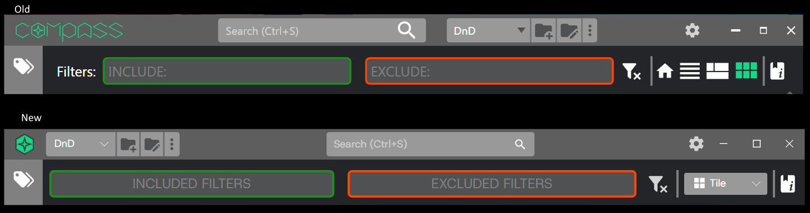
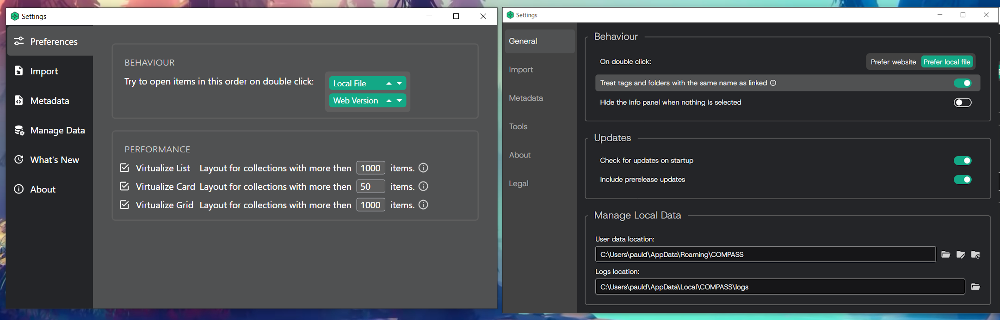
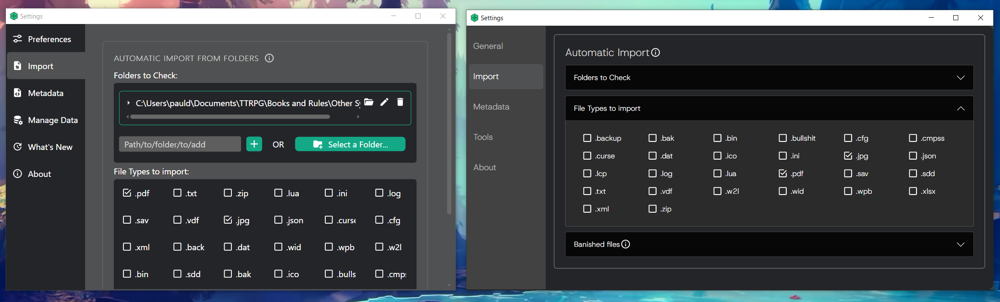
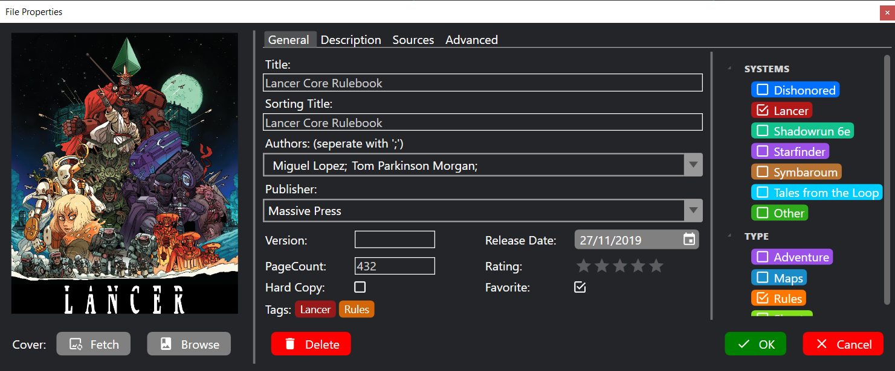
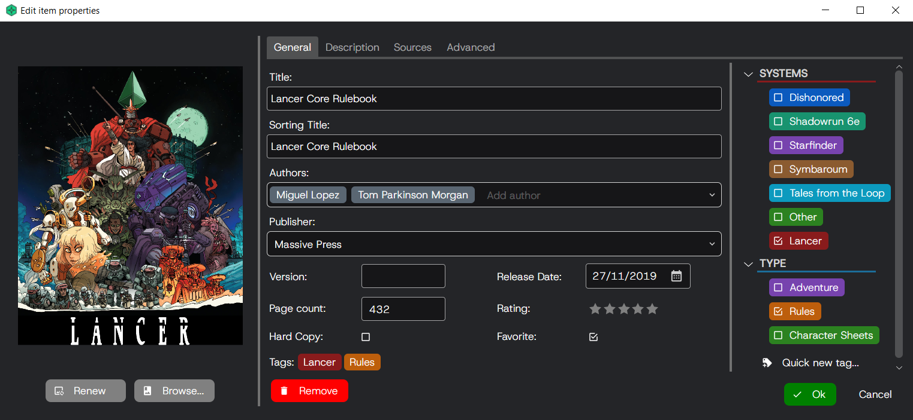
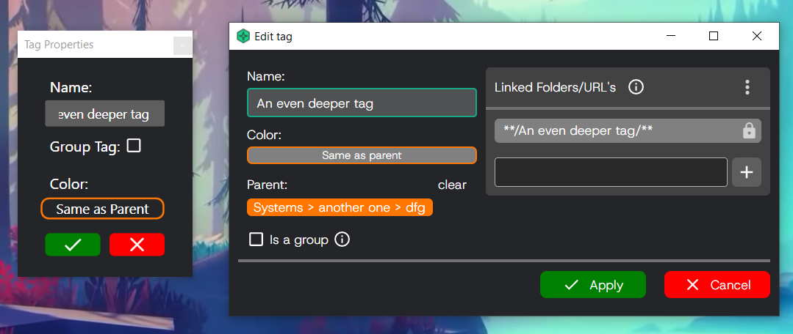

# From WPF to Avalonia: porting COMPASS

A short write-up about how I migrated my application, COMPASS, to Avalonia. COMPASS was first written in 2019 as a personal project to learn how to ship an actual piece of production-ready software from start to finish. Making it cross-platform is the next step in this journey. This write-up answers the why, when and how, and offers some reflection on the pros and cons now that it is complete. A before and after gallery is at the end.

> **Scope note.** When I was going through a rewrite of this size anyway, I used it as an opportunity to improve the application architecture as a whole. This write-up however focuses on the changes related to the goal of replacing the UI framework from WPF with Avalonia and making the application cross-platform. Other refactors are discussed at the end.

## Contents

1. [Why Avalonia](#1-why-avalonia)
2. [The plan](#2-the-plan)
3. [Required changes](#3-required-changes)
4. [Timeline](#4-timeline)
5. [Actually shipping to multiple platforms](#5-actually-shipping-to-multiple-platforms)
6. [Reflection](#6-reflection)
7. [AI?](#7-ai)
8. [Unrelated refactors](#8-unrelated-refactors)
9. [Screenshots](#9-screenshots)

---

## 1. Why Avalonia

Let's start with why Avalonia was chosen as the replacement for WPF in the first place.
I got a lot of questions about Linux and macOS versions from the community. The main goal of this refactor was to make the application available for those users. There are however multiple UI frameworks that enable this. I started searching with the following criteria:

- Within the .NET ecosystem, so that I can keep my code that doesn't relate to the UI
- Runs on Windows, Linux and macOS. Bonus points for mobile and web
- No downgrades. It had to be at least as stable, feature rich and performant as WPF
- Free and open source
- Actively maintained with a big userbase and ecosystem
- Nice to work with (aka good tooling and nicer syntax than WPF)

This narrowed it down to three contenders:

- .NET MAUI
- Avalonia UI
- Uno

.NET MAUI was quickly eliminated because it feels mobile first and desktop second, which I didn't love, it didn't officially support Linux, and I had also never heard a good word about it from developers I know.

Avalonia won over Uno for me because of its bigger community and ecosystem, and because it is marketed as a direct replacement for WPF, which matched my goal and criteria perfectly.

## 2. The plan

After Avalonia was chosen, I had a look at all the work that needed to be done.
The work could be divided into two phases.

Phase 1: Replace all dependencies and code that is Windows-only with a cross-platform alternative. During phase 1, the application still runs WPF.

Phase 2: Rip out WPF and replace it with Avalonia. When everything around WPF is cross-platform, I could rip out WPF itself. This involved rewriting all views, restructuring the project and replacing all logic that used WPF primitives like bitmaps.

By splitting the work in two phases, I could do the rewrite on the main branch for as long as possible, which allowed me to still easily fix bugs and add small features. Only in phase 2 did I have to create a new parallel branch to finish the port. When phase 2 started, I did a feature freeze on the application so that I wouldn't have to write every feature twice, once for WPF and once for Avalonia.

## 3. Required changes

First I looked at my dependencies to see which ones weren't cross-platform.
Then I looked at what replacement options were available. Those that work with both WPF and Avalonia were replaced in phase 1, the rest in phase 2.

### Dependencies

In phase 1:

- MVVM: Replaced my own `ObservableObject` with CommunityToolkit.Mvvm, which has first-class support in Avalonia. I chose it over ReactiveUI because I preferred the simplicity.
- Preferences: Moved the storage of my application settings and preferences from the WPF-provided `Settings.settings` to an XML file that is managed by the application itself.
- Testing: MSTest → NUnit
- Compression: DotNetZip → SharpCompress
- Dialogs: `MessageBox.Show` → custom notification system

In phase 2:

- Material icons: MaterialDesignInXAML → Material.Icons.Avalonia
- Folder dialog: `Ookii.Dialogs.Wpf` → Avalonia `StorageProvider`
- Drag & drop: `gong-wpf-dragdrop` → Avalonia `DragDrop`
- Virtualized 2D layout: `VirtualizingWrapPanel` → custom implementation
- Images: `System.Drawing` → Avalonia `Bitmap`, SkiaSharp
- GIFs: `WpfAnimatedGif` → `Avalonia.Labs.Gif`
- Barcode decoding: `ZXing.Net` + Windows bindings → OpenCV barcode detector over SkiaSharp bitmaps
- Image capture: OpenCvSharp webcam → FlashCap
- Updates: `Autoupdater.NET` → custom implementation

As you can see, the difficulty of these changes varied greatly.

Some features became much easier because they are natively supported by Avalonia, where they had to be bolted on in WPF, like the folder dialog. Some features had a direct replacement that was straightforward to swap out. But some features had no direct replacement that I liked and required me to just write it myself, because the Avalonia ecosystem, while big, is just not as big as WPF's. We will get back to this later.

You might notice that some of the entries in phase 2 could have been done in phase 1 with better planning, namely barcode scanning, image capture and updates. I however was unsure what I was going to replace them with when I started the port and saved them for the end.

### Project structure

In WPF, the entire application was one .NET project. To support divergent logic on Windows and Linux, I had two options:

- One shared executable, using `System.OperatingSystem` to gate platform-specific logic
- A project per platform, using dependency injection to inject a platform-specific implementation into the shared logic

I decided on the second for two main reasons:

- It is the recommended approach in the Avalonia documentation
- Some packages like OpenCvSharp have rather large, platform-specific binaries, and having one project would mean shipping all runtimes to all platforms

### Rewriting the UI

This was one of the biggest tasks. While Avalonia has very similar syntax and components to WPF, there are some crucial differences that took considerable time to port, the biggest one being theming and styling, which use a completely different system of selectors. I also wanted to keep the look and feel I had in WPF, which meant tweaking all theming for all controls. I just went view by view, control by control and eventually got through them all. 

### Miscelanious

There are many features that you wouldn't immediately think of when you think "just changing the UI framework" that needed porting, such as:

- Changing the dispatcher to dispatch logic from a background thread to the UI
- Keyboard/shortcut handling
- Showing modals is async in Avalonia but synchronous in WPF
- Making sure all logic that touches file paths is platform-agnostic
- Creating a deploy and update strategy for all platforms
- Setting up CI for cross-platform testing and deployment
- No built-in splash screen, unlike WPF
- Asset loading is different
- Crash handling. WPF still allows you to show UI when an unhandle exception is detected. Avalonia however does not. Instead I had to restart the application with a --crash argument followed but the error The application than shows the crash dialog with the error on startup, rather than the main application, prompting the user to submit a crash report and restart. 
- Upgrade to .NET 10 in the process

## 4. Timeline

The first commit towards the Avalonia port happened on March 17, 2024. The port was completed on October 17, 2026, so it took around 2.5 years, close to 500 commits and around 45k changed lines. Keep in mind that this includes a lot of refactoring that is unrelated to the WPF to Avalonia port itself. I also by no means worked on this full-time: it all happened on evenings after my day job and during weekends.

The first six months were spent on those phase 1 changes. I was also still actively developing the application at that point, which took some time away from the port.

I then created the Avalonia projects for Windows and Linux, as those would be the first two platforms I would support, and started copying my logic into them file by file, fixing things where needed. By December I could launch the application, see the main window, and perform some basic interactions, like opening a file.

The next year was spent painstakingly recreating every view. I did not simply want to copy in my WPF XAML and perform the minimal amount of edits to make it compile. I took this opportunity to redesign each screen, improving the UX wherever I could. I also wanted to take full advantage of the improved features that Avalonia offers, like `Spacing` on `StackPanel` and row and column spacing on `Grid`, the vastly improved ergonomics of relative sources, and compiled bindings.

The next six months were spent on porting the hardest parts that I had been putting off.
This included my custom solutions for drag and drop, barcode scanning and 2D virtualization.
A lot of time was also spent here on writing tests, improving performance, and improving code quality and structure.

Finally, on June 28, 2026, the first alpha of the Avalonia port was released. It got the honor of being the first major version bump, 2.0.0, with the first stable release following in October.

## 5. Actually shipping to multiple platforms

### Platform-specific services

While most logic runs fine on both Windows and Linux, there were some areas where custom logic was needed for separate platforms. I have been able to limit the platform-specific code to three services. Care was also taken to ensure import and export of date works across platform boundries.

#### IOService

As the name implies, this service interacts with the system's file system. Avalonia already has an excellent abstraction around it, so most code here is still shared, with one exception: `ShowInExplorer`. That requires starting the right application with the right parameters, which differs from platform to platform.

#### UIService

This service manages any discrepancies in the UI due to the platform it runs on. For now it only holds how much space should be reserved in the title bar for window controls. On macOS it would need to be reserved on the left, on Windows on the right, and on Linux none, as the window still retains its own separate title bar.

#### UpdateService

This one handles updating the application, which is closely linked to how the application is deployed, so I will refer to that section that is coming up shortly.

### Deployment

Now that everything is ported, it still needs to be deployed. I strongly considered all-in-one solutions like Velopack and Parcel. In the end I chose to use a dedicated deployment tool for each platform, mostly because I already had a working deploy using Inno Setup on Windows that I did not want to touch.

#### Windows

Here I use Inno Setup to create the installer. This is the same setup as before the migration.
For updates the application checks the latest GitHub release and downloads the Inno installer if it's newer. Inno installers can double as updates if they detect the application is already installed.

#### Linux

Here I chose to deploy the application as a Flatpak. I wanted a single format that worked on most distros, rather than having to create a separate .rpm and .deb and so on.
I chose Flatpak over AppImage because I was more familiar with it and it seemed to be preferred by many people.
It was also easier to test, as I used my Steam Deck, which primarily uses Flatpaks, to test the Linux build and deploy flow. To keep the Flatpak up to date, a submission to Flathub is underway, so that users can install it with `flatpak install` and update it with `flatpak update`.

#### macOS

While I would love to ship to macOS and don't think it would be too much work now that the port to Avalonia is complete and the solution is properly set up for cross-platform development, I do not own a Mac and shipping an application for macOS without one is pretty much impossible. Even if I could, I am not comfortable shipping a macOS version when I am not able to properly test it on my own hardware. Given that COMPASS is a completely free and open source project, I don't make any money off this, and the odd donation I get here and there doesn't even cover the $20 a month for the compassapp.info domain name.

### CI

The build and packaging for both Windows and Linux are completely automated through GitHub Actions. One workflow runs the entire test suite on each supported platform and finishes with a smoke test that publishes the app, launches it and verifies it survives startup. A second workflow builds the installer for Windows and the Flatpak bundle for Linux, then drafts a release that includes both artifacts.

## 6. Reflection

Overall I am extremely happy with this port. The application is now available to many more people, and it also performs significantly better, has fewer bugs, and is much nicer to work with. If I were to start a new desktop application tomorrow, I would choose Avalonia again.

### The pros

After completing the migration, these are some of the things that made me love Avalonia and make me never want to go back to WPF again:

- Visibility is a boolean; bye-bye `BoolToVisConverter`, I never liked you anyway
- The selector-based style system with pseudo-classes is so much nicer to work with than style triggers
- Compiled bindings, an absolute game changer that not only squashed bugs but allows my IDE to reliably navigate from the view to the view model using "Go to definition"
- Spacing properties on containers: this seems like a small one, but it makes creating layouts with consistent spacing so much easier than having to add margins on every single control
- Syntactic sugar like inline `Grid` row and column definitions and shorthand relative bindings
- Async bindings, so a `Task<T>` property can be bound directly with the `^` operator
- Implicit conversions and many useful built-in converters
- Much easier to move UI to the title bar. In WPF I had to essentially hide the title bar, and then recreate a fake one that reimplements dragging, minimize, maximize and close
- Actively developed. Every major update brings a feature I had been looking forward to. Such a breath of fresh air to be part of something that continues to get better, rather than something that is slowly withering away

### The cons

Overall I much preferred my time with Avalonia over WPF, but there are still some areas where it falls short.

- Drag and drop: this is by far the biggest one. `gong-wpf-dragdrop` is awesome and, as far as I can tell, has no Avalonia equivalent. I ended up using Avalonia's built-in drag and drop functionality and building my own abstractions on top of it to improve its ergonomics. But the lack of a preview of the dragged item that follows the cursor is greatly missed.

- No virtualized 2D layout such as `UniformGrid` or `WrapPanel`; only the stack panel virtualizes out of the box. I have a large image grid in my application, so this was essential. WPF once again has a great library for this, `VirtualizingWrapPanel`. I had to write my own here to restore that functionality. I have seen some PRs come and go here, but none have made it through so far.

- Async dialogs: I am sure there is a good technical reason why opening a dialog in Avalonia is async, but so much code that used to be simple and synchronous in WPF had to become async just to be able to show an "Are you sure?" dialog, and then every method calling it needs to become async, and then every method calling that one, ...

- No built-in hot reload. After trying a bunch of the options out there, `HotAvalonia` was the only one that worked for me, and it isn't perfect either. They released an official hot reload just after I was pretty much done with the port, but they put it behind a paywall. I am in full support of them putting their more advanced controls and one-click deploy behind a paywall to make development sustainable, but hot reload really should have been free.

- That my build logs are littered with an ad:

  > Avalonia Accelerate Community requires telemetry. To opt out, please upgrade to a paid tier. Learn more: https://avaloniaui.net/accelerate/

## 7. AI?

You might think that AI would be perfectly capable of taking a WPF app and porting it to Avalonia, given how similar they are. So how did it take me over two years to complete this?

First of all, when I started this journey in March 2024, AI was far less capable than it is today. Claude 3 had just been released, and we were all still copy-pasting code from the chat to our files.
The similarity between WPF and Avalonia also caused more problems here than it solved, with LLMs regularly confusing the two and reverting to the old WPF way of doing things while claiming it is valid Avalonia syntax. For these reasons I quickly gave up on that and decided to do it all by hand.

Limiting AI involvement in this port forced me to actually learn Avalonia, dive deep into the docs and the source code, and learn proper architecture. It also allowed me to retain a deep understanding and familiarity with the entire codebase. As time went on and agentic coding became better, I did start leaning on LLMs more and more for the more tedious tasks: writing tests, writing docs, reviewing my code, restructuring the codebase, and so on. This document, however, was entirely written by me, at 1 a.m. the day before the deadline like a real human would.

## 8. Unrelated refactors

As I alluded to in the beginning, much of the work in this port had nothing to do with Avalonia at all, but was all about building better foundations. It included:

- UX tweaks across the board when a view had to be rewritten anyway
- More project separation. As I explained, there is now an entry project per platform, and then a shared project with all the shared logic. This shared project was split up into three major parts:
    - **Infra**: the bottom layer, which handles what you would expect — logging, DI, extension methods on .NET classes such as strings and collections, web scraping tools, and so on
    - **Infra.Avalonia**: infra code that depends on Avalonia, such as behaviors, converters, custom controls, drag and drop, view model validation, a wizard, and so on
    - **Common**: the actual domain models and logic
- Proper dependency injection in many more places
- Reorganized the project to group files in a namespace by feature, rather than by type

## 9. Screenshots

These are some screenshots taken throughout the porting process comparing the old WPF to the new Avalonia. You might notice the theming is quite similar. Considerable effort was spend on rebuilding the original theming to ensure continutiy between the old and new application. 

Every screenshot puts the old WPF build on the left (or on top) and the Avalonia build on the right (or below). Same application, same collection, same data.

### Title bar

This is where the framework swap is most direclty visible. On WPF the bar is a fake: the window chrome is hidden and the minimize, maximize and close are recreated. In Avalonia the client area extends into the real decorations, so the caption buttons belong to the platform and the rest is just a row of controls.

### Main Window

The main layout has remained similar in style with some improvements. 
Search bars is now front and center, collection switching is off to the left as it has gained tab functionality. It's options have also been collapsed into the 3 dots menu. Sorting has been moved from a side pane on the left to a button with a flyout on the top right, next to the reworked layout selection, from a wall of icons to a dropdown with the customization of that layout right beside it, which also used to be a sidepane. The cards themselves no longer label every every field, using font weight and size to convey this information instead.  

### Settings

Settings have better contrast, better grouping using the Avalonia Groupbox and expander, and generally a more consitent design language. 

### Edit item properties

All text entry has a much softer and more modern feel. I have also created a combobox that allows multiple selection which is used for the authors, instead of the old ; seperation hack. 

### Tag editor

This panel gained validation, much more spacious UI, clearer hierarchy and a feature to link it to a folder that used to live in settings where it was hard to find. 

### Recordings

Two short recordings of the same collection, showcasing the massive improvment to responsiveness. The WPF build first and the Avalonia build second. Most markdown viewers, GitHub included, don't play a repository video inline, so these are links:

- [COMPASS on WPF (before)](COMPASS_Before.mp4)
- [COMPASS on Avalonia (after)](COMPASS_New.mp4)

## Further reading

- [Architecture overview](https://github.com/DSPAUL/COMPASS/blob/dev/Docs/Architecture.md) — what the app looks like after the port
